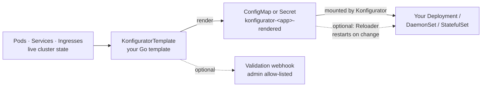

#  Konfigurator

**Configuration that follows your cluster.** Konfigurator is a Kubernetes operator that renders
Go templates against the *live* Pods, Services and Ingresses in your cluster, writes the result
into a ConfigMap or Secret, and mounts it into the workload that needs it. When the cluster
changes, the config is re-rendered. Nobody edits a ConfigMap by hand again.

[](https://stakater.github.io/stakater-charts)
[](#requirements)
[](go.mod)
[](https://slack.stakater.com/)

## The problem

Some configuration can't be written once. It depends on *what is running right now*:

- A **log shipper** needs a parsing rule per application. Every new app, every renamed
  container, means someone edits the fluentd config and restarts it.
- A **proxy or gateway** that isn't Kubernetes-aware needs the current list of backends.
- An **agent** needs to know which pods carry a certain annotation today.

Helm and Kustomize render at deploy time, so their output is stale the moment a pod is
rescheduled. Baking a watcher into every application image is a lot of plumbing for a config
file. The usual answer is a human with `kubectl edit`, at 3 a.m.

## What Konfigurator does

You write one `KonfiguratorTemplate`. Konfigurator does the rest.



1. **Render.** Your template sees `.Pods`, `.Services` and `.Ingresses`, plus ~40 helper
   functions (`where`, `groupBy`, `parseJson`, `distinctPodsByOwner`, …).
2. **Store.** The output lands in a ConfigMap or a Secret, your choice.
3. **Mount.** Konfigurator adds the volume and the mount to the container you name. No image
   change, no sidecar.
4. **Repeat.** The template is re-rendered on the schedule you set (`updateFrequency`, default
   every 2 minutes), so the config tracks the cluster.
5. **Reload.** Because the output is a real ConfigMap/Secret, [Reloader](https://github.com/stakater/Reloader)
   (`reloader.stakater.com/auto: "true"`) restarts the workload when it changes. Konfigurator
   renders, Reloader reloads; neither needs to know about the other.

## Sixty seconds to a live config

An nginx that needs an upstream per Service in the `shop` namespace:

```yaml
apiVersion: konfigurator.stakater.com/v1alpha1
kind: KonfiguratorTemplate
metadata:
  name: edge-upstreams
  namespace: shop
spec:
  renderTarget: ConfigMap          # or Secret
  updateFrequency: 1               # minutes
  app:
    name: edge                     # the Deployment to mount into
    kind: Deployment               # Deployment | DaemonSet | StatefulSet
    volumeMounts:
    - mountPath: /etc/nginx/upstreams
      container: nginx
  templates:
    upstreams.conf: |
      {{- range .Services }}{{ if eq .Namespace "shop" }}
      upstream {{ .Name }} {
        server {{ .Spec.ClusterIP }}:{{ (index .Spec.Ports 0).Port }};
      }
      {{- end }}{{ end }}
```

Apply it. Within a minute `/etc/nginx/upstreams/upstreams.conf` exists in the `nginx`
container, lists every Service in `shop`, and keeps up as Services come and go. Add Reloader
and nginx restarts on each change.

The real-world example this project grew from is **per-application multiline log parsing with
fluentd**: apps declare their log format in an annotation, and Konfigurator turns those into
fluentd `<filter>` blocks. [Read the walkthrough.](examples/parsing-multiline-logs-with-fluentd.md)

## When to use it, and when not to

| Use Konfigurator when… | Reach for something else when… |
|---|---|
| An app reads a **config file** that depends on other workloads in the cluster | The app already does **native Kubernetes discovery** (Prometheus `kubernetes_sd`, fluent-bit's kubernetes filter, Envoy/xDS, an ingress controller). Use that; it's event-driven and purpose-built |
| You **can't or won't change the image** (vendor software, legacy agents, shared platform tooling) | You own the app and can call the API from inside it |
| Config must be a **Kubernetes object** (so Reloader, GitOps diffing, RBAC and audit apply) | A **value known at deploy time** is enough: Helm/Kustomize do that better |
| A few minutes of lag is fine (log parsing rules, dashboards, allow-lists, upstream lists) | You need **sub-second reaction** to pod churn, e.g. a load balancer's live member list. Konfigurator renders on a timer |
| The inputs are **Pods, Services or Ingresses** | You need other kinds, or data outside the cluster. Write a controller, or ask for the kind as an [issue](https://github.com/stakater/Konfigurator/issues) |

## Compared with the alternatives

| | Konfigurator | Helm / Kustomize | In-image renderers (kubegen, kube-gen, confd, consul-template) | A custom controller |
|---|---|---|---|---|
| Renders against live cluster state | ✅ | ❌ deploy-time only | ✅ | ✅ |
| Needs changes to the app image | **No** | No | **Yes** (binary/sidecar + reload script) | No |
| Output | ConfigMap / Secret, **auto-mounted** | manifests | a file inside the container | whatever you build |
| Reload on change | via Reloader, zero code | n/a | you write it | you write it |
| Multiple files per template | ✅ | ✅ | usually one | ✅ |
| Validation before applying | optional webhook | lint | ❌ | you write it |
| Effort | one CR | n/a | per-app plumbing | days to weeks |

Detailed comparisons: [vs kubegen](docs/konfigurator-vs-kubegen.md) · [vs konfd](docs/konfigurator-vs-konfd.md).

## Features

- **Two CRDs.** `KonfiguratorTemplate` is the product. [`PodMetadataInjector`](docs/PodMetadataInjector.md)
  adds annotations to pods *as your templates see them*, for workloads whose operators won't let you
  annotate pods directly. It never touches real pods.
- **Go templates with batteries.** `where`, `whereExist`, `groupBy`, `groupByMulti`, `parseJson`,
  `json`, `dict`, `distinctPodsByOwner`, `coalesce`, `when`, string helpers and more.
  [Full reference.](docs/konfigurator-template.md)
- **ConfigMap or Secret** output, mounted into the container you name on a Deployment,
  DaemonSet or StatefulSet. Deleting the template unmounts and cleans up.
- **Optional validation webhook.** Rendered output is POSTed to a validator you run (a fluentd
  config checker, a JSON-schema check) before it is applied. Hosts are allow-listed by the cluster
  admin; calls are bounded (10 s, 64 KiB, no redirects).
- **Safe failure modes.** Invalid specs are rejected at admission. Errors that depend on cluster
  state retry on the next cycle; transient errors back off; nothing is retried forever.
- **Namespaced by default.** The chart installs Konfigurator watching its own namespace. Cluster-wide
  mode is an explicit admin choice (see Security).

## Install

```bash
helm repo add stakater https://stakater.github.io/stakater-charts
helm repo update
helm install konfigurator stakater/konfigurator \
  --namespace konfigurator --create-namespace \
  --set deployCRD=true
```

`deployCRD=true` installs the CRDs with the release. Leave it off if you manage CRDs separately
(see [`config/crd/bases`](config/crd/bases)). Then create a `KonfiguratorTemplate` in the same
namespace as the workload it configures.

### Requirements

- **Kubernetes ≥ 1.30** (OpenShift ≥ 4.17). The chart enforces this via `kubeVersion`; the
  reason is CRD validation ratcheting, which lets older invalid templates still be deleted.
- Upgrading from a release before `0.1.40`? Read the [upgrade notes](CHANGELOG.md) first: the
  validation webhook is now opt-in via an allow-list.

### Scope: one namespace or the whole cluster

By default (`WATCH_NAMESPACE` = the release namespace) templates see only the Pods, Services and
Ingresses of **their own namespace**, and the operator holds only namespaced permissions in
practice. To let one Konfigurator serve every namespace, set `WATCH_NAMESPACE` to `""`:

```yaml
env:
- name: WATCH_NAMESPACE
  value: ""
```

**Read this before you do:** in cluster-wide mode every template can read every pod spec in the
cluster, including environment variables. Only enable it on clusters where all template authors
are trusted equally. Per-namespace scoping inside cluster-wide mode is on the roadmap (H.3).

## Security model, honestly

- The operator writes only the objects it creates (`konfigurator-<app>-rendered`) and the
  volume/mount on the workload you name.
- Webhook destinations are chosen by the **cluster admin** (`validationWebhook.allowedHosts`), never
  by the template author, so templates can't be used to probe or exfiltrate.
- The CRD schema rejects unsupported kinds and targets at admission; the controller cannot be
  crash-looped by a bad template.
- Known gaps, tracked publicly in [docs/reviews](docs/reviews/2026-11-17-baseline-review.md) and
  [docs/roadmap.md](docs/roadmap.md): cluster-wide mode exposes pod specs across namespaces (H.3);
  rendered-object names are per app, so two templates for one app collide (H.5).

## Status

Konfigurator has run in production since 2018. In November 2026 it went through a full
hardening pass: current Go and Kubernetes libraries, admission validation, a bounded webhook,
race-free deletes, classified error handling, a kind-based e2e suite and mutation-tested error
paths. What's next, and what's deliberately not done yet, is in the
[roadmap](docs/roadmap.md). Changes per version: [CHANGELOG.md](CHANGELOG.md).

## Documentation

- [KonfiguratorTemplate reference](docs/konfigurator-template.md): every field and template function
- [PodMetadataInjector](docs/PodMetadataInjector.md)
- [Example: multiline log parsing with fluentd](examples/parsing-multiline-logs-with-fluentd.md)
- [Releasing](docs/releasing.md) · [How this project is built](docs/method.md)

## Help

**Got a question?** File a GitHub [issue](https://github.com/stakater/Konfigurator/issues), or
talk to us on Slack:

[](https://slack.stakater.com/)
[](https://stakater-community.slack.com/messages/CC8R7L8KG)

## Contributing

PRs are welcome. We follow the fork-and-pull workflow: fork, branch, commit, push, open a PR.
Read [`CLAUDE.md`](CLAUDE.md) for how changes are planned, tested (`make verify`) and
reviewed here, and [docs/releasing.md](docs/releasing.md) for how a merge becomes a release.

## License

Apache License 2.0 © [Stakater](https://stakater.com)

## About

`Konfigurator` is maintained by [Stakater](https://stakater.com). Like it? Tell us at
<hello@stakater.com>. See [our other projects](https://github.com/stakater), or contact us for
professional services and queries.
