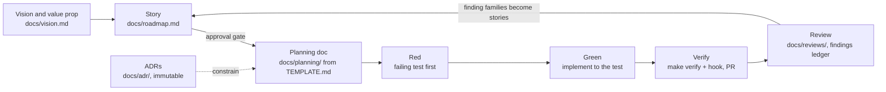

# How Konfigurator is built — story → plan → red → green → verify → review

This is the Stakater working method. It's ported from `kube-ward/docs/method.md`, where it
was codified (Story DX.1) after an evaluation against **BMAD v6** (2026-09-16).
**This is not a BMAD install.** We take the parts of BMAD with real substance:

- the **context-capsule story file**, which here is the planning doc;
- the **explicit approval gate** between a drafted story and building it.

We deliberately keep our own on the rest:

- persistent memory instead of persona hand-offs;
- immutable ADRs instead of a mutable architecture doc;
- a review/evidence loop that feeds new stories.

## The loop

There are two loops:

- **Inner build loop:** story → plan → red → green → verify. It ships one story end to end.
- **Outer evidence loop:** review → Draft fix stories → re-review. It checks whether shipping
  made the product better.

`docs/reviews/2026-11-17-baseline-review.md` is the first turn of the outer loop.

## The practices, and where each is enforced

| Practice | What it looks like here | Enforced by |
|---|---|---|
| Spec first | vision → story → planning doc, **before any code** | `CLAUDE.md` workflow; the planning doc is committed before implementation |
| Immutable decisions | `docs/adr/`: an accepted ADR is never edited, only superseded | convention + review |
| Story-driven delivery | house story format + a **Done:** line + the lifecycle below; one story at a time | roadmap convention; PRs cite the story code |
| Test-first | red → green → refactor, table-driven, controller-runtime fake client / envtest at the seams | `make verify` PostToolUse hook (`hack/verify-hook.sh`) on every Go edit |
| Adversarial review | `/code-review`: independent finder angles, cross-verified, fixes re-reported with outcomes | review flow; findings ledger in `docs/reviews/` |
| Context persistence | `CLAUDE.md` invariants + memory + context-capsule planning docs | `docs/planning/TEMPLATE.md` |

## Story lifecycle

- **📝 Draft:** written down so it isn't lost, and explicitly *not* agreed. It may be
  re-scoped or killed. Killing a weak Draft is the method working, not failing.
- **👍 Approved:** a human said build it. An unapproved story never starts. Comply-by-default
  is the failure mode.
- **🔨 In progress:** one at a time, end to end.
- **✅ Done:** the Done line is met, `make verify` is green, and the planning doc is linked.

## The planning doc is a context capsule

`docs/planning/TEMPLATE.md` is the contract. A planning doc must carry enough context that a
**cold session** (no memory, no chat history) can execute the story without re-scouting the
repo. It covers:

- the story and its why;
- the governing ADRs/invariants;
- the exact files and seams;
- the test list, red first;
- what's explicitly out of scope.

## Invariants of the method

1. **No code without a red test that demanded it.**
2. **No implementation without a committed plan. No plan without a story. No story built
   without approval.**
3. **Honesty over completeness.** "Couldn't verify / not assessed" beats a confident guess.
   A fix nobody measured is still only a claim.
4. **Docs move with the code.** A behavior change that leaves `docs/` or the README stale is
   unfinished.
5. **The review loop closes.** A fix names the finding id it closes. The next review checks it.
